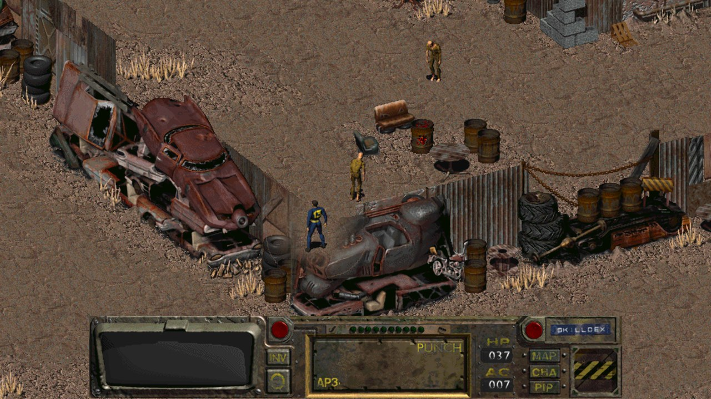
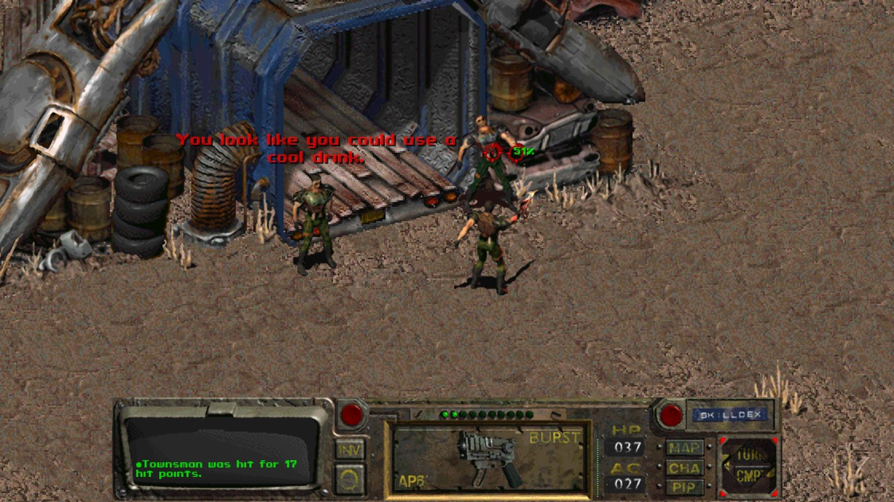
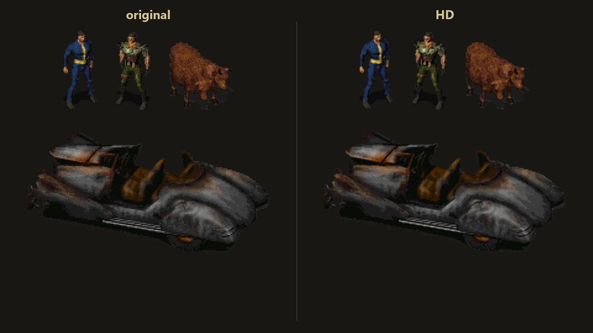
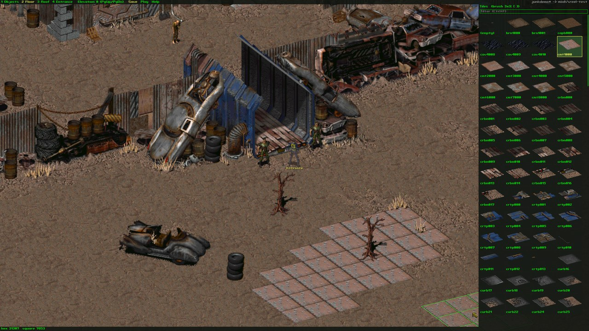

# Fallout Demo HD

A native 64-bit Windows version of the 1997 Fallout demo, with 4x sprites, an open, moddable data
format and a map editor. It runs on a new engine (Direct3D 11, XAudio2 and its own script
interpreter), and the demo's own maps, scripts and dialogue run on it unchanged.



This repository contains no game data. You need `FALLDEMO.DAT` from the Fallout demo. On the first
start the game converts it into a `data\` folder of PNG, JSON, WAV and text files, which you can
edit or override with mods.

## Building

You need Windows 10 or 11 (x64) and Visual Studio 2019 or 2022, or the Build Tools for Visual
Studio, with the **Desktop development with C++** workload. There are no other dependencies: PNG,
zlib and the movie decoder are part of the project.

```
git clone https://github.com/radosc/f1demo
cd f1demo
build.bat
```

`build.bat` finds Visual Studio on its own, so an ordinary command prompt is enough. It writes
`bin\FalloutDemoHD.exe`. `build.bat debug` makes a debug build.

## Running

1. Copy `Falldemo.dat` from the demo into the `f1demo` folder, next to `build.bat`. The game also
   looks one folder higher, and asks for the file if it finds none.
2. Run `bin\FalloutDemoHD.exe`. The first start converts the demo data. That takes about a minute
   and a half and 850 MB of disk space (most of it is the 4x critter animations), and a small window
   shows the progress.
3. In the main menu, **NEW GAME** opens the character selection. **TAKE** starts with the shown
   character, **MODIFY** opens the character editor and **CREATE CHARACTER** starts from scratch.

After the first start the folder looks like this:

```
f1demo\
  Falldemo.dat     your copy of the demo
  bin\             FalloutDemoHD.exe
  data\            converted game data
  mods\            mods; mods.txt sets which ones load
  user\            settings, save games, screenshots
  MapEditor.cmd    starts the map editor
```

To convert by hand, run `bin\FalloutDemoHD.exe --convert Falldemo.dat` in the `f1demo` folder.
`--scale 2` gives 2x sprites at about a quarter of the size.

The window can be resized freely, and **Alt+Enter** switches to fullscreen. The interface keeps the
original 640x480 layout, scaled to the window, and the **mouse wheel** zooms the world.

`package.bat` puts the game, the documentation and the mods folder into `dist\FalloutDemoHD` for
sharing (`package.bat withdata` also copies the converted data).

## Controls

The controls from the demo manual all work:

| Key | Action | Key | Action |
|---|---|---|---|
| Left click | walk / act on target | Right click | switch Move / Command cursor |
| Shift+click, double click | run | Click and hold (Command) | action menu |
| A | attack mode (target cursor) | B | swap active item (hands) |
| N | cycle item mode (single, aimed, burst, reload...) | M | toggle mouse mode |
| C | character screen | I | inventory |
| P | Pip-Boy (clock, rest, status, clues, automaps) | S | skilldex |
| Tab | automap | O / Esc | options (Esc ends combat while fighting) |
| 1..8 | sneak, lockpick, steal, traps, first aid, doctor, science, repair | ? | date and time |
| < > (comma, period) | rotate the player | Enter / Space | end combat / end turn |
| F1 | help screen | F2 / F3 | volume down / up |
| - / + | brightness | F10, Ctrl+Q, Ctrl+X | quit to the main menu |
| F12 | screenshot | Home | centre on the player |

New in this version: **F6** quick save, **F9** quick load, **mouse wheel** zoom, **arrow keys** or
the screen edges to scroll, and **Ctrl+D** for a debug overlay (map, hex, zoom, object count).
Saving and loading work from the options menu (**O**) and from **LOAD GAME** in the main menu; the
original demo had them disabled.

## What it has



* **The whole demo:** Scrapheap with its townspeople, their scripted dialogue and quests, turn-based
  combat with the original to-hit, damage and critical hit rules and AI packets, inventory, looting,
  stealing, skills, drugs, doors and containers, the character editor, Pip-Boy, automap, skilldex,
  help screen, the death and demo-end screens, and the intro and credits movies.
* **4x sprites:** the converter redraws every sprite at 4x. Critters, scenery, walls, items and the
  interface go through an edge-directed upscaler with smooth edges. Floor tiles and art with animated
  palette colours (monitors, fire, water) use a palette-preserving pixel-art scaler, so the colour
  cycling still works. This is an algorithm, not hand-drawn art, and hand-made sprites of any integer
  scale can replace any sheet (see MODDING.md).
* **Open data and mods:** everything the game reads is a plain file in `data\`, and a mod in `mods\`
  overrides any of them without touching the base data.
* **Map editor:** places and moves objects, paints floor and roof tiles, sets the entrance and object
  scripts, and saves maps into a mod. **F5** in the editor starts the game on the map.



Not included: a world map and talking heads, because the demo has neither.

## Map editor and modding



`MapEditor.cmd` opens the editor on the demo map, and `MapEditor.cmd mytown` creates a new map. **F1**
in the editor lists the keys. Maps are saved to `mods\my-maps\maps\`, and `data\` is never changed.

[MODDING.md](MODDING.md) describes the data layout: sprites and their metadata, prototypes, maps,
scripts and dialogue, characters, rule tables (critical hits, perks, AI packets) and sounds.
`mods\example-mod` is a small working mod.

## Command line

| Option | Meaning |
|---|---|
| `--convert <dat> [--out dir] [--scale 2\|4] [--hd-style smooth\|pixel] [--no-hd] [--no-art] [--only-art]` | convert the demo data (`--no-art` keeps the existing sprites) |
| `--data <dir>` | use another converted data folder |
| `--map <name> [--premade combat\|stealth\|diplomat]` | skip the menus and start on a map |
| `--editor [map] [--mod <folder>] [--save-as <name>]` | map editor (saves to `mods\<folder>\maps\`, default folder `my-maps`) |
| `--width <w> --height <h>`, `--fullscreen`, `--no-vsync` | window options |
| `--skip-movies` | no Interplay logo and intro at start-up |
| `--no-hd` | draw the original-resolution art |
| `--hd-preview <sheet.png> <prefix>` | write smooth and pixel 4x versions of one sprite sheet |
| `--combat-log` | log every combat turn and AI decision to `bin\fo1hd.log` |
| `--record <file.mp4> [--record-fps 30] [--ffmpeg <path>]` | record a video with sound (needs ffmpeg); the game runs at a fixed time step while recording |

Testing aids: `--hidden`, `--mute`, `--seed <n>`, `--fixed-fps <n>`, `--test-talk <script>`,
`--test-attack <script>`, `--screenshot <file> --frames <n> [--exit-after-screenshot]` and
`--auto "<frame>:<command>;..."`, which plays scripted input: `click x y`, `rclick x y`, `down x y`,
`move x y`, `glide x y frames`, `up`, `wheel n`, `key [ctrl+][shift+]k`, `type text`,
`shot file.png` and `dev use|talk|attack|goto|walk|tp|give|equip|center|scroll ...`. Coordinates are
in the 640x480 interface layout.

## Source layout

* `src\core`: virtual file system and mods, JSON, PNG and zlib, DAT reader
* `src\gfx`: palette and colour cycling, Direct3D 11 renderer, sprites, fonts, the 4x upscalers
* `src\convert`: the FALLDEMO.DAT to open data converter
* `src\game`: rules, objects, maps, the script VM and its opcodes, animation, pathfinding, combat and
  AI, actions, dialogue, perks, save games
* `src\ui`: application shell, all screens, the movie player, the map editor and the video recorder
* `src\audio`: XAudio2 sound
* `src\media`: Interplay MVE movie decoder (`tools\build_mvedump.bat` builds `mvedump`, which writes
  a movie's frames as PNG and its sound as WAV)
* `src\res`: rule tables built into the executable and written to `data\rules` by the converter

## Legal

Fallout and the demo's data belong to their owners. This repository contains no game data: the game
reads your copy of the demo and converts it for personal use. The demo's executable was not used.

The engine was written with the open-source [fallout1-ce](https://github.com/alexbatalov/fallout1-ce)
as its reference for the game's rules and formats, and some code and rule tables were adapted from
it. Those parts are under the Sustainable Use License, which allows free, non-commercial
distribution only. [THIRD_PARTY_NOTICES.md](THIRD_PARTY_NOTICES.md) lists them and includes the
license.
